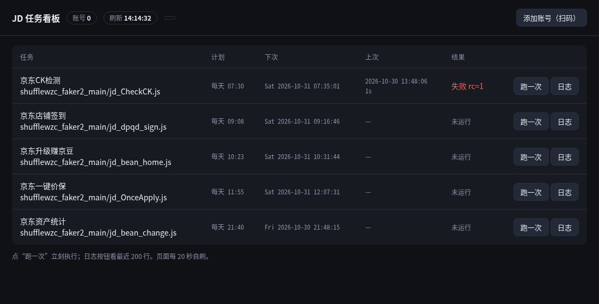
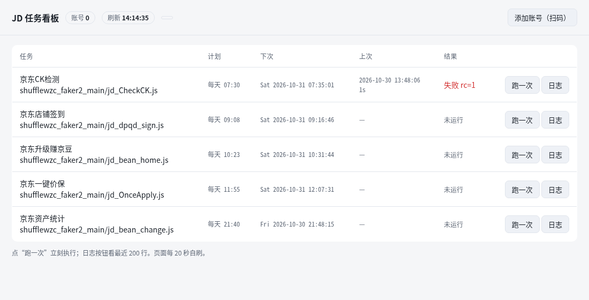

# 京东任务自动化平台

青龙太重，我把它砍成了 systemd + 一个单文件看板。

- **`lean/`：推荐版**。systemd timer + node，88MB、0 常驻内存、不开端口，配一个单文件看板（扫码加账号、手动跑任务、看日志）。
- **根目录：完整版**。青龙（docker）做调度 + 订阅拉脚本 + 用 Python 封装青龙 API 的引导脚本。

两个版本都能用，区别只是要不要一个现成 Web 面板和订阅自动更新。

## 先看这些

- [能力边界](#2-能力边界先说清楚省得白折腾)：h5st 签名之后，农场/牧场/京喜那批纯 HTTP 脚本大面积失效，别指望全绿。
- [反黑号清单](#5-反黑号清单比脚本本身重要)：单账号、错峰、不碰互助脚本、并发=1。
- [极简版](#9-极简版不要青龙lean推荐自用)：不想要青龙的从这里开始。
- [看板与扫码取 CK](#10-看板与自动取-ckleanpanelpy--leanc_krjs)：扫码怎么取 CK，为什么纯 HTTP 扫码已经废了。
- [机器位置的影响](#11-这台机器在哪以及地理位置的代价)：机房 IP 跑京东的真实代价，外加一个时区坑。

## 极简版快速开始

```bash
tar -xzf jd-lean.tar.gz -C /tmp/lean
sudo APP_DIR=/opt/jd-cron OWNER=$USER bash /tmp/lean/install.sh
# 浏览器打开 http://<本机IP>:8088 ，默认 admin，密码在 /opt/jd-cron/.env 的 PANEL_PASS
```

装完得到 5 个定时任务（CK 巡检、店铺签到、升级赚豆、一键价保、豆子日结）+ 一个看板。
脚本来自 [shufflewzc/faker2](https://github.com/shufflewzc/faker2)，**本仓库不内置任何京东脚本**。

## 免责声明

- 本项目只做调度与观测，不包含任何京东脚本，也不破解任何签名算法。
- 用脚本操作京东账号**违反其用户协议**，后果是账号侧处置（限权/黑号/封号）。自担风险，别拿主号试。
- 禁止用于代挂、收 CK、对外提供服务等场景。
- 仓库内不含任何真实 Cookie、密码或密钥；`.env`、`ck.txt`、日志、数据目录已在 `.gitignore` 排除。

---

一句话：**能搭，而且不难搭 —— 但"平台"这个词要拆开看。**
调度、依赖、多账号、通知、CK 生命周期管理这些工程问题都好解决；
真正的天花板是京东的 **h5st 签名 + 账号风控**，那不是搭平台能解决的，是脚本作者在替你解决。

本项目就是那层"平台"：`青龙（调度/依赖/变量） + 订阅脚本（别人维护签名） + CK 管道 + 巡检告警`。

---

## 1. 架构：四层，缺一层就跑不起来

```
┌─ 采集层 ─────────────────────────────────────────────┐
│ 扫码/抓包拿 pt_key+pt_pin  →  ck.txt  →  ck_push.py  │  ← 7 天过期，必须半自动
└──────────────────────┬───────────────────────────────┘
                       ↓ 环境变量 JD_COOKIE
┌─ 调度层 青龙 ────────┴───────────────────────────────┐
│ crontab 错峰  ·  python3/nodejs 依赖  ·  linux 包    │
└──────────────────────┬───────────────────────────────┘
                       ↓ task xxx.js / python3 xxx.py
┌─ 脚本层 ─────────────┴───────────────────────────────┐
│ faker4 订阅（jd_*.js，内置 h5st）                    │
│ 自用库（农场类，走浏览器调试端口签名）                │
└──────────────────────┬───────────────────────────────┘
                       ↓ 日志 / 豆子
┌─ 观测层 ─────────────┴───────────────────────────────┐
│ ck_watch.py 巡检  ·  notify.py 多通道  ·  logs/*.json │
└──────────────────────────────────────────────────────┘
```

**关键认知**：青龙本身不产生任何"能力"，它只是 cron + 依赖管理 + 变量管理。
所以"搭平台"≈ 把上面四层的缝补好。缝没补好，典型症状：

| 症状 | 根因 | 修法 |
|---|---|---|
| 任务日志里全是 `404` / `活动结束` | 脚本那层签名过期了 | 换订阅源，或只保留 README 里标 ✅ 的任务 |
| 农场类 `首页返回 405` | 容器里没 `chromium/xvfb`，无头环境拿不到签名 | `ql_bootstrap.py` 里的 linux 依赖 |
| 跑了一周突然豆子归零 | 账号被风控/黑号 | 降到单账号 + 关互助 + 错峰，等 1~2 周 |
| 第 8 天开始所有任务报登录失效 | ck 过期了，没人管 | `ck_watch.py` 每日巡检 + 告警 |
| 面板里变量一堆 `JD_COOKIE` 废条目 | 按 `pt_key` 判重，key 每周都换 | 本项目按 `pt_pin` 判重 |

---

## 2. 能力边界（先说清楚，省得白折腾）

**能做**：签到、日常浏览任务、部分活动任务、豆子统计推送、库存/价格监控。
**做不了（纯 HTTP）**：东东农场/牧场、京喜签到、超市签到 —— 这些要 h5st，得靠社区 JS 脚本或浏览器内核。

所以这个平台的正确定位是：**把"能跑的那部分"稳定跑住，跑不了的如实报错**，而不是假装全绿。
`993052100-sketch/jd-qinglong` 的 README 里那张"2026-10 实测校准表"就是这个思路，值得照抄。

---

## 3. 十分钟部署

### 3.1 前置

- Docker Desktop 已安装并**启动**（`docker info` 有输出）
- 端口 5700 空闲
- Node 22 / Python 3.13（只用于宿主机跑管理脚本）

### 3.2 三步

```powershell
cd E:\Desktop\AI研究\jd-auto-platform
Copy-Item .env.example .env      # 改 QL_PASS 和通知配置
.\run.ps1 up                     # 起容器
```

浏览器开 `http://127.0.0.1:5700` → **设置 admin 密码** → 把密码写回 `.env` 的 `QL_PASS`。

```powershell
.\run.ps1 init                   # 装依赖 + 建订阅 + 建定时任务（幂等）
.\run.ps1 push -DryRun           # 先空跑看 payload 对不对
.\run.ps1 push                   # 真推 ck
```

面板里进「订阅管理」点一次 **运行**，把脚本拉下来，然后等 cron 自己跑。

### 3.3 验证

```powershell
.\run.ps1 watch      # 每个 ck 打一次 me-api，输出 valid / expired
.\run.ps1 ps         # 容器健康 + 任务列表
```

---

## 4. 文件说明

| 文件 | 作用 |
|---|---|
| `docker-compose.yml` | 青龙单容器，数据在 `./ql-data`，`./data` 挂成容器内 `scripts/local` 放自用脚本 |
| `run.ps1` | 唯一入口：`up/init/push/watch/ps/logs/upgrade/down` |
| `scripts/ql_bootstrap.py` | 依赖 + 订阅 + 定时任务，幂等，支持 `--dry-run` |
| `scripts/ck_push.py` | CK 入库，按 `pt_pin` 去重，日志里 key 脱敏 |
| `scripts/ck_watch.py` | CK 巡检，单线程随机延迟 2~5s，存 `logs/*.json` |
| `scripts/notify.py` | 企微 / TG / Bark / Server酱，只用标准库 |
| `ck.txt` | 你的 CK，**已被 .gitignore 排除** |

---

## 4.5 部署到 instabox（Linux 常驻，推荐）

本机 Docker 没起也能玩，但真正该待的地方是那台 24h 开着的机器。
`deploy/` 就是给 instabox（Debian 13）准备的，**只多了三件事**：`BIND_IP=auto`（只绑 tailscale IP，面板不暴露公网）、root 检查、docker 缺失自动装。

打部署包：

```powershell
cd E:\Desktop\AI研究\jd-auto-platform
.\deploy\pack.ps1            # 产物 dist\jd-auto-deploy.tar.gz (~12KB)
```

上传并装（在能免密登录 instabox 的机器上）：

```bash
scp dist/jd-auto-deploy.tar.gz instabox:/tmp/
ssh instabox 'mkdir -p /opt && tar -xzf /tmp/jd-auto-deploy.tar.gz -C /opt/jd-auto-src 2>/dev/null || true'
# 更省事的做法：解压到临时目录后直接跑 install.sh
ssh instabox 'sudo bash /tmp/jd-auto-deploy/install.sh'
```

或者一条命令搞定（install.sh 自己会建 `/opt/jd-auto`）：

```bash
ssh instabox 'tar -xzf - -C /tmp/jd-auto-deploy && sudo bash /tmp/jd-auto-deploy/install.sh' < dist/jd-auto-deploy.tar.gz
```

装完输出面板地址（默认 `http://<tailscale-ip>:5700`）。数据在 `/opt/jd-auto/ql-data`，**备份就打包这一个目录**。

`install.sh` 行为要点：

| 情况 | 行为 |
|---|---|
| 没装 docker | 走 `get.docker.com` 装（第一次会拉 ~300MB） |
| 有 tailscale | 面板只绑 `tailscale ip -4`，公网/局域网都摸不到 |
| 端口被占 | 直接报错退出，不猜 |
| `.env` 已存在 | 保留你的密码，只更新 `BIND_IP` |
| 重复执行 | 幂等，不重建 `ql-data` |

---

## 4.6 已部署实例（instabox，2026-10-30）

| 项 | 值 |
|---|---|
| 机器 | 云上小机器（Debian 13 / 4C8G / 20G 数据盘），tailscale 内网直连 |
| 面板 | `http://<tailscale-ip>:5700`（只绑 tailscale IP，公网摸不到） |
| 账号 | `admin` / 密码在机器上 `/data/apps/jd-auto/.env` 的 `QL_PASS` |
| 目录 | 程序 `/data/apps/jd-auto`，数据 `/data/apps/jd-auto/ql-data`（20G 持久盘） |
| 青龙 | 2.24.0，容器名 `ql`，`restart: unless-stopped` |

装完实测通过的：登录鉴权、拉库 faker2、5 条定时任务、`task` 执行落到脚本、容器 `--force-recreate` 后依赖仍在。

**三个踩过的坑，代码里已修**：

1. 青龙 2.24 把登录从 `PUT` 改成 `POST`，未初始化面板返回 `450`，首次要用 `PUT /api/user/init` 建管理员。
2. 2.24 的写接口形状全变了：依赖要**数组**，任务/订阅要**对象**，订阅还必须带 `schedule_type`+`alias`，且 `depend` 字段被移除（传了 400 `not allowed`）。
3. 青龙自带「依赖管理」在这台机器上**0 秒失败**，任务日志表现为 `Cannot find module 'axios'`。`install.sh` 现在直接用 `npm -g --prefix /ql/data/dep_cache/node` 装好，再 `cp` 到青龙自己的依赖目录 `/ql/data/deps`（在持久盘上，重建容器不丢）。

**拉库后的默认任务有 82 条**，大部分是互助/助力类。`ql_bootstrap.py --prune` 只保留 5 条：

| 任务 | cron | 说明 |
|---|---|---|
| 京东CK检测 | `30 7 * * *` | 失效就推告警 |
| 京东资产统计 | `40 21 * * *` | 豆子日结 |
| 京东店铺签到 | `8 9 * * *` | 真签到 |
| 京东升级赚京豆 | `23 10 * * *` | |
| 京东一键价保 | `55 11 * * *` | |

**注意这台是免费额度机**：`autoSuspendAfterSeconds=1800`（空闲 30 分钟自动暂停）＋ `maxRunMinutes=480`。
机器暂停时 cron 不会触发，所以 **09:08 的店铺签到你不在线就白等**。
要真 24h 值守，只有两条路：付费计划把 auto-suspend 关掉，或者挪到 `home-docker`/`pve` 那种常开的机器上。

---


## 5. 反黑号清单（比脚本本身重要）

1. **单账号起步**。多账号不是量变，是风险叠加，且同一出口 IP 最容易被串查。
2. **cron 全部错峰**。整点、整分是风控最容易抓的特征，本项目的任务表已经避开了。
3. **不要跑互助类脚本**（`*_help` / 助力池）。这类行为特征最明显，是封号主因。
4. **并发 = 1**。青龙默认并发跑任务，多账号叠加就是并发；农场类必须串行。
5. **别用第三方"代挂"**。你把 `pt_key` 交出去，等于交出账号；而且那些平台通常一个 IP 挂几千账号。
6. **豆子有价，账号更有价**。为了每天几十豆把用了十年的账号跑黑，账不划算。

---

## 6. 维护节奏（这平台是活的，不是装完就完事）

| 频率 | 动作 |
|---|---|
| 每天 | 看 `bean_change` 推送：数字突然掉 0 → 查风控 |
| 每周 | `ck_watch.py` 有 expired 就重新扫码 `ck_push.py` |
| 每周 | 面板看订阅「运行」是否报错，报错就换源 |
| 每月 | `docker compose pull` 升级青龙；顺手删掉日志里连续 30 天返回 404 的任务 |

---

## 7. 排错速查

```powershell
docker compose ps                       # 容器状态
docker compose logs --tail=100 ql       # 面板自身日志
docker exec -it ql sh                   # 进容器
docker exec -it ql ql check             # 内置自检
docker exec ql ls /ql/data/scripts      # 脚本有没有拉下来
```

青龙 API 直接摸（bootstrap 失败时手动确认）：

```powershell
$t = (Invoke-RestMethod -Method Put -Uri http://127.0.0.1:5700/api/user/login `
      -ContentType application/json `
      -Body '{"username":"admin","password":"你的密码"}').data.token
Invoke-RestMethod -Uri http://127.0.0.1:5700/api/crons -Headers @{Authorization="Bearer $t"}
```

---

## 8. 合规与风险（一次说完，不重复）

- 脚本自动化操作京东账号，**违反《京东用户协议》**，后果是账号侧处置（限权/黑号/封号），不是法律问题。
- **不要对外提供服务**：帮别人跑、收 CK、做"代挂平台"，性质就变了 —— 涉个人信息与账号安全，风险量级完全不同。
- 订阅脚本的作者声明普遍是"仅供学习测试"，实际使用后果自负。
- 所有 CK 只存在本机 `./ql-data` 和 `ck.txt`，别提交、别上传网盘、别贴群。

---

## 9. 极简版：不要青龙（`lean/`，推荐自用）

5 个脚本、1 个账号，青龙是真的多余。它给的是「面板 + 多账号环境变量 + 订阅自动更新 + 日志浏览」，
这些在单人自用场景里等于给 766MB 镜像、一个 Web 漏洞面、以及一堆会变形的私有 API 买单。
（我为了让青龙 2.24 跑起来，先撞了三个：登录 `PUT`→`POST`、写接口 array/object 全都换、`depend` 字段被删。）

`lean/` 版本只有 systemd timer + node，全部内容 3 个 shell 文件：

| 文件 | 干的事 |
|---|---|
| `lean/run.sh` | 跑一个脚本：flock 单实例、随机抖动、日志留 14 天、`timeout` 兜底、`JD_COOKIE` 从 `.env` 注入 |
| `lean/sync_ck.sh` | 把 `ck.txt` 按 `pt_pin` 去重写进 `.env` 的 `JD_COOKIE`，跳过被截断的 key |
| `lean/install.sh` | 拉库 → `npm install` → 生成 5 个 `jd-*.timer` → `systemctl enable --now` |

装：

```bash
sudo APP_DIR=/data/apps/jd-cron OWNER=user bash install.sh
sudo /data/apps/jd-cron/sync_ck.sh          # 先放好 ck.txt
sudo systemctl start jd-checkck.service     # 立刻验一次
systemctl list-timers 'jd-*'
```

**实测量级对比**（同一台 instabox）：

| | 青龙版 | 极简版 |
|---|---|---|
| 磁盘 | 766MB 镜像 + 292MB 数据 | 88MB（其中 node_modules 70MB） |
| 常驻内存 | 约 300MB（pm2 + node 面板） | 0（timer 触发才起 node，跑完就退） |
| 端口暴露 | 5700 面板 | 无 |
| 外部依赖 | docker + 镜像 + 私有 API | node + systemd |
| 版本漂移炸点 | 青龙每次升级可能改接口 | 只跟脚本作者 |

**两个必须记住的依赖坑**（`install.sh` 已锁）：

- `got` 必须 `got@11`：`sendNotify.js` 用 CommonJS 的 `got.extend`，装成 14 会 `got.extend is not a function`。
- 还要一个 `undici`（node 22 内置 fetch 走它，部分 utils 直接 require）。

**多出来的一个好处**：`Persistent=true` —— 机器被暂停/重启错过时间点，恢复后会补跑一次。
青龙那套 cron 是"错过就没了"，免费额度机的 auto-suspend 正好克它。

想回退青龙：`cd /data/apps/jd-auto && sudo docker compose start`（容器只是 stop，没删）。

---

## 10. 看板与自动取 CK（`lean/panel.py` + `lean/ck_qr.js`）

极简版不留命令行裸跑，配了个单文件看板：`python3 -c 'import http.server'` 级别的东西，标准库、
无框架、无前端构建，一个 7KB 的 HTML 内联在 py 里。

访问：`http://<tailscale-ip>:8088`，HTTP Basic，账号 `admin`，密码在 `.env` 的 `PANEL_PASS`。
只绑 tailscale 网卡，不监听 0.0.0.0。

页面上能干：

| 动作 | 后端 |
|---|---|
| 看 5 个任务的下次触发、上次结果、耗时 | `systemctl list-timers` + 日志解析 |
| 「跑一次」立刻执行 | `sudo -n systemctl start --no-block`（sudoers 只放行 `jd-*.service` 的 start） |
| 「日志」看最近 200 行 | 读 `logs/<脚本>-<日期>.log` 尾部 |
| 「添加账号（扫码）」 | 起无头 chromium 打开京东登录页，截二维码 → 你手机扫 → cookie 自动写入 |

### 10.1 登录方式怎么选（2026 现状）

| 方式 | 可行性 | 代价 |
|---|---|---|
| **扫码登录（已实现，推荐）** | 京东 APP 扫，密码不落地，机器上只存 `pt_key` | 需要 chromium（`apt install chromium`，机器上已有 156.0） |
| 手动粘 cookie | 浏览器 F12 复制 `pt_key;pt_pin`，贴进看板「手动粘贴」 | 零依赖，但每次都手动 |
| 短信验证码 | 可以，但要浏览器 + 手机收码，还会撞滑块 | 半自动，麻烦 |
| 账号密码 | **不做**。密码要存到机器上，还要过滑块/风控，失败率高、风险最大 | —— |

### 10.2 为什么必须开浏览器

京东早期那套纯 HTTP 扫码链路（`qr.m.jd.com/show` → 拿 `qr_id` → `check` 轮询 → `login.action` 换票）
已经废了，实测：

- `qr.m.jd.com/show` 不带会话 cookie 返回的是 **766 字节的占位图**，不是真二维码，也不下发 `qr_id`；
- `qr.m.jd.com/check` 直接回 `{"code":257,"msg":"参数异常，请退出重试"}`；
- `passport.jd.com/new/login.aspx` 页面里也搜不到 `token=`。

现在的二维码跟**浏览器会话**绑定：必须在真实浏览器里渲染，扫完的 `pt_key` 也落在那个浏览器的
cookie 里。所以 `ck_qr.js` 干的就是——无头 chromium 打开登录页 → 截 `#passport-main-qrcode-img`
→ 每 2 秒查一次 cookie 里有没有 `pt_key` → 有就写 `ck.json`，面板读走合并进 `.env`（按 `pt_pin` 去重）。

真码截图留档在 `docs/qr-proof.png`（147×147 截出来 172×172，中间是京东狗，扫得出来）。

### 10.4 扫码会不会把账号搞异常

先说结论：**扫码本身不会**。它是京东官方给的登录方式，和你自己在电脑上点"扫码登录"是同一件事，
不绕过任何验证。真正影响账号的是另外三样，按权重排：

| 因素 | 影响 | 我们的处理 |
|---|---|---|
| **登录 IP**（最大变量） | 国内账号从美西机房登录，异常信号最强 | 见第 11 节：主号别放这台，搬回家宽 |
| **新设备记录** | 每次用全新浏览器 = 每次一台新设备，容易触发"登录保护/短信验证" | **固定 profile**（`ck_sessions/profile`），重复扫码认作同一台设备 |
| **登录后的行为** | 高频跑活动接口、多账号并发，这才是封号主因 | 单账号、单实例锁、错峰、只留 5 条任务 |

几种取 CK 方式的风控风险（低 → 高）：

1. **复用已有有效会话** —— `ck_qr.js` 打开登录页先验证 profile 里旧的 `pt_key` 还有效
   （打 `me-api.jd.com/user_new/info/GetJDUserInfoUnion` 看 `retcode=0`），有效就直接续上，
   **不扫码、不产生新的登录事件**。
2. **手动贴 cookie** —— 把已登录设备的会话搬过来，不新增登录记录，但 IP 变了。
3. **扫码** —— 新增一次设备登录（有固定 profile 时是同设备），叠加异地 IP。
4. **账号密码** —— 密码要落盘 + 新设备 + 异地 + 滑块，最重，本项目不做。

操作上的硬规矩：

- 首次只扫一个号，扫完先只跑 `jd_CheckCK`，观察 24h 内 `pt_key` 会不会被踢；
- 同一账号 24h 内重复扫码 ≤ 1 次（看板已做会话复用，连点不会连开浏览器）；
- 手机扫码时用 4G/5G，别让手机也挂在境外节点上，保证"常用登录地"对得上；
- 一旦收到"账号存在异常登录风险"，立刻停掉所有任务，在常用设备上手动登录一次、改密码，静置 7 天再动。


### 10.5 几个踩过的坑

- `install.sh` 里生成密码别用 `tr -dc ... | head -c 16`：`pipefail` 下 `head` 提前退出会让整条管道失败，
  `set -e` 直接把安装脚本中断在半路（表现：tasks.json 之后无声退出）。
- 单元里别塞 `Environment=JITTER_MIN`：抖动已经在 `RandomizedDelaySec` 做了，再加一层会让
  「跑一次」按钮先睡最多 15 分钟，看起来像卡死。
- `cp -f A A` 返回 1，`set -e` 下同样会中断，所以自拷贝要带 `|| true`。
- 无 CK 时脚本 `rc=1` 是正常的（脚本自己退 1 提示"请先获取Cookie"），看板显示"失败"别慌。

---

## 11. 这台机器在哪，以及地理位置的代价

InstaBox 的机器元数据里没有 region 字段，所以直接从机器上探：

| 项 | 实测值 |
|---|---|
| 出口 IPv4 | 云厂商机房地址（实测为 AWS `us-west-2` 段） |
| 出口 IPv6 | 同一机房段的 v6 地址 |
| 机房 | **AWS us-west-2 / 美国俄勒冈州 Boardman**（45.84, -119.70，AS16509） |
| tailscale | 节点 `instabox`，最近 DERP 中继 Seattle |
| 系统时区 | `Etc/UTC`（默认，不是北京时间） |

### 11.1 时区坑（已修）

系统时区是 UTC，`OnCalendar=*-*-* 07:30:00` 会被理解成 **07:30 UTC = 15:30 北京**，五个任务全部错位 8 小时。
systemd 257 支持在 `OnCalendar` 里显式带时区，现在单元里写的是：

```
OnCalendar=*-*-* 07:30:00 Asia/Shanghai
```

`run.sh` 里也 `export TZ=Asia/Shanghai`，`jd-panel.service` 带 `Environment=TZ=Asia/Shanghai`，
所以脚本内部的时间判断、看板显示的下次触发都是北京时间，不受宿主时区影响。

### 11.2 真正的问题：美西机房 IP 跑京东

这不是"能不能跑"的问题，是"账号值不值"的问题：

- 京东看到的是**美国数据中心 IP + 异地登录**，风控权重远高于家用宽带。表现是 `pt_key` 更容易被踢
  （CK 频繁失效）、部分活动接口直接返回"活动太火爆/请稍后再试"。
- 家庭宽带（`dell` / `home-docker` / `pve` 那几台）出口是住宅 IP，地理位置也对得上，风控画像正常得多。
- 而且这台是免费额度机：空闲 30 分钟自动暂停 + 单次最长 480 分钟，本身也不适合当 7×24 值守。

结论：**这台适合当"开发/验证机"，要长期挂主号，搬回家里那台**。搬家成本很低——`lean/install.sh`
是幂等的，把 `dist/jd-lean.tar.gz` 拷过去 `sudo APP_DIR=/opt/jd-cron bash install.sh` 就行，
`.env` 拷走即可（CK 和面板密码都在里面）。
---

## 12. 现役部署（家用 Debian 机器）

云上那台（AWS us-west-2）验证完就停掉了，跑京东要用住宅 IP。现在的部署形态：

| 项 | 值 |
|---|---|
| 宿主 | Debian 13 (trixie) / 6.12 内核 / 62G 系统盘 / 时区本身就是 Asia/Shanghai |
| 目录 | `/opt/jd-cron`（scripts、logs、tools、ck_sessions、.env） |
| 看板 | `http://<内网IP>:8089`（8088 被别的服务占了，所以换了端口） |
| 服务 | `jd-panel.service` + 5 个 `jd-*.timer` |
| 依赖 | apt 装 `nodejs(npm 9)`、`chromium 156`；npm 装 `axios/ws/png-js/moment/dotenv/crypto-js/date-fns/jsdom/undici/got@11` + `puppeteer-core` |

从公网仓库直接装（不用拷文件）：

```bash
git clone --depth 1 https://github.com/ByteJuno/jd-auto-platform.git /tmp/jdrepo
sudo APP_DIR=/opt/jd-cron OWNER=$USER PANEL_BIND=<内网IP> PANEL_PORT=8089 bash /tmp/jdrepo/lean/install.sh
```

坑：`PANEL_PORT` 以前写死 8088，和已有服务撞端口，已改成可用环境变量覆盖（commit `d0a5844`）。
---

## 13. 看板配色：跟随系统

深色是默认，浅色跟随浏览器/系统的 `prefers-color-scheme`，不留硬编码颜色——所有颜色都收在 CSS 变量里，
浅色只是覆盖一组变量：

```css
:root{color-scheme:dark light;--bg:#0f1115;--card:#171a21;--txt:#e6e9ef;...}
@media (prefers-color-scheme:light){
  :root{--bg:#f5f6f8;--card:#fff;--txt:#1b2129;...}
}
```

几点值得记的：

- `<meta name="color-scheme" content="dark light">` + CSS `color-scheme` 一起写，浏览器原生控件
  （滚动条、textarea 调整柄、`dialog` 背板）才会一起变色，否则浅色下滚动条还是黑的。
- 二维码区域用独立的 `--qrbg`，**永远是白底**——二维码反色之后手机扫不出来。
- 无头 chromium 截自己的面板截图前记得 `apt install fonts-noto-cjk`，否则中文全是豆腐块（只影响截图，不影响功能）。

深色：



浅色：


### 10.6 二维码为什么总是"已过期"，以及怎么修的

最初的实现是**截一张图然后死等**：grabQr 截完就进入轮询，最多等 QR_TIMEOUT=180 秒。
两个问题叠在一起：

1. 京东二维码自己只有 **1~2 分钟**有效期，180 秒的等待窗口比它长——用户看到的永远是"已过期"；
2. 过期之后没有任何地方会去重新加载登录页，图片始终是同一张，所以"也不刷新"。

改成**分片轮转**：每 QR_REFRESH_SECONDS=70 秒重新加载登录页换一张新码，
整场会话最多 QR_SESSION_SECONDS=600 秒。status.json 里加了 （第几张），
面板只在  变化时才重新拉图（原来每 2 秒带时间戳重下一遍，等于白耗流量）。

另外两个坑：

- **同一个浏览器 profile 只能有一个实例**。上一个会话没退干净时，新实例起不来，
  面板就永远停在"正在拉起浏览器…"。现在用 ck_sessions/.ck_qr.lock（写 pid）互斥，
  抢不到锁直接返回"已经有一个扫码会话在跑"，而不是假装在启动。
- 面板点"添加账号"时会先 pkill -f tools/ck_qr.js 清掉卡死的旧会话，再起新的。

实测（70 秒一换，三张码的 sha256 全不同）：

`
[  8s] state=qr v=1  861A6442F241 11041B
[ 82s] state=qr v=2  2C3E571A7880 10762B
[153s] state=qr v=3  4BB36A005CF4 11142B
`

顺带记一个容易误判的现象：首页打开时  可能先返回  且取图 404（qr not ready），
那是浏览器还在 starting，不是出错——面板会自动重试。
### 10.7 手机显示"登录成功"但 cookie 没写进来（真机踩到）

现场：手机京东点完确认，手机弹"登录成功"，面板一直停在等扫码，.env 里没账号。

排查第一步是看**浏览器到底有没有收到票**——直接查 chromium 的 cookie 库：

`ash
python3 - <<'PY'
import sqlite3
c = sqlite3.connect('file:/opt/jd-cron/ck_sessions/profile/Default/Cookies?mode=ro', uri=True)
print(c.execute("select host_key,name from cookies where name in ('pt_key','pt_pin')").fetchall())
PY
# -> []  空的
`

库是空的，说明 pt_key 从来没落到这台浏览器上。原因在"换码"的实现方式：

- 京东扫码登录不是扫码就完事。手机确认后，**PC 那个页面自己要去轮询并收票**
  （qr.m.jd.com/check → passport.jd.com/uc/qrCodeTicketValidation → Set-Cookie: pt_key）；
- 老实现换码是 page.goto(LOGIN_URL)，**把旧页面销毁了**。用户扫的如果是旧页面那张码，
  京东服务端接受了扫码（所以手机显示成功），但收票的 JS 已经随页面一起没了，
  票就烂在那儿，cookie 永远写不进来。

修法：**旧页面不关**。每张二维码都活在自己的标签页里，换码时开新标签页，只保留最近两张；
收 cookie 时遍历所有活着的页面（同一个浏览器上下文，哪张被扫都能读到）。顺带加固：

- 拿到 pt_key 后再打一次 me-api.jd.com/.../GetJDUserInfoUnion，
etcode=0 才算成功；
- 页面出现「扫描成功/请在手机确认」时，状态栏直接透出"已扫码，请在手机上点确认"，
  不用再猜是没扫上还是没确认；
- 换码 100 秒一次（京东码约 2 分钟有效），两张同时在手，等于给用户 200 秒的窗口；
- 家宽 DNS 会抖（实测出现过一次 ERR_NAME_NOT_RESOLVED），换码失败重试 3 次，
  还失败就继续用手里那张、30 秒后再试，绝不因为一次网络抖动把整场会话打死。
### 10.8 撞到京东"账号安全认证"（aq.jd.com）怎么办

真机跑出来的完整链路（
et.log）：

`
check → {"code":202,"msg":"请手机客户端确认登录"}
check → {"code":200,"ticket":"AAEAMGiijKhno8g0lNpgtZhes..."}
/uc/qrCodeTicketValidation?...          响应体为空（没有 Set-Cookie）
NAV  passport.jd.com/relay/loginRelay?rurl=//aq.jd.com/certified/index?...
NAV  https://aq.jd.com/certified/index?p=...&o=LOGIN&s=pc_main&i=...
`

结论：**票拿到了，但换 pt_key 这一步被风控拦去"账号认证"**。这是新设备登录的保护，不是代码 bug，
所以 cookie 库里始终没有 pt_key——手机显示"登录成功"也没错，服务端确实接受了扫码。

处理方式（面板已内置）：

1. ck_qr.js 一旦监测到跳转 q.jd.com / certified/index，就切到 
eed_verify 状态，
   把认证页整页截图存成 erify.png；
2. 面板此时会显示京东那个认证页 + 一个验证码输入框；
3. 手机上会收到短信，填进面板点「提交」→ 面板写 code.txt → ck_qr.js 代你填进页面并提交；
4. 认证通过后 pt_key 落地，**这台浏览器 profile 被记成可信设备**，以后同一 profile 扫码不再走认证。

关于"续期"，把话说清楚：

- pt_key 有滑动过期——只要还在用（每天 07:30 的 jd_CheckCK 就会带着它访问一次），
  服务端会顺延，不存在"每天要重新扫码"这回事；
- 真的失效，基本是被踢（异地登录、多设备、风控），这时才需要重新取一次；
- 重新取一次的最短路径就是这个「扫码 + 填一次短信码」，或者手动粘 cookie 兜底。
